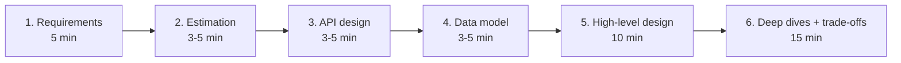
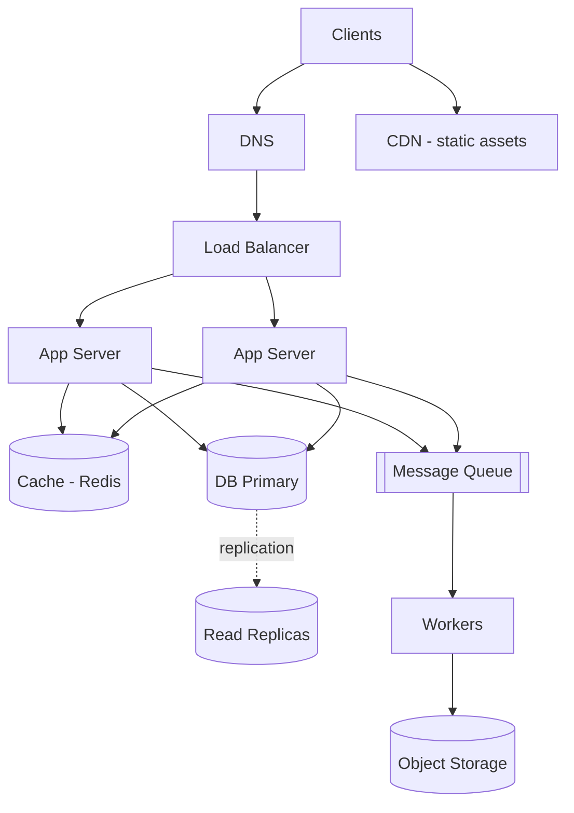

# The System Design Interview Framework

## 1. What it is
A repeatable 45–60 minute structure so you never freeze and never skip what the interviewer is scoring.

## 2. What interviewers actually score
| Signal                 | What they look for                                           |
|------------------------|--------------------------------------------------------------|
| **Problem navigation** | Do you clarify scope instead of charging ahead?              |
| **Solution design**    | Is the high-level design correct and complete?               |
| **Technical depth**    | Can you go deep on 1–2 components when pushed?               |
| **Trade-offs**         | Do you state *why* you chose X over Y, and what you give up? |
| **Communication**      | Do you drive the conversation, think aloud, check in?        |

## 3. The 6-step structure (45-min timings)



### Step 1 — Requirements (never skip)
**Functional** — what the system does. Pin down 3–5 core features, explicitly park the rest.
> "For this session I'll focus on: shorten URL, redirect, and expiry. I'll park analytics and custom aliases unless you want them."

**Non-functional** — the *quality* targets that drive architecture (full guide: [03-non-functional-requirements.md](03-non-functional-requirements.md)):
- Scale: DAU, read/write ratio, data size
- Latency: p99 target (e.g. redirect < 100 ms)
- Availability vs consistency: which matters more *for this product*?
- Durability: can we ever lose data?
- Geography: single region or global?

### Step 2 — Back-of-envelope estimation
QPS (avg + peak), storage over N years, bandwidth, cache memory. See [02-back-of-envelope-estimation.md](02-back-of-envelope-estimation.md).
Goal is **order of magnitude**, and to say what the numbers *imply* ("12K read QPS → one DB can't serve this alone, we need a cache").

### Step 3 — API design
REST (or gRPC) signatures for each functional requirement.
```
POST /v1/urls            { longUrl, expiresAt? }  → 201 { shortCode }
GET  /{shortCode}                                  → 302 Location: longUrl
```
Mention: auth, pagination (cursor-based), idempotency keys for writes, rate limiting.

### Step 4 — Data model
Entities, key fields, access patterns → choose SQL vs NoSQL, pick primary key / partition key.

### Step 5 — High-level design
Draw the boxes: Client → DNS/CDN → Load Balancer → Stateless services → Cache → DB / Queue / Blob store.
Walk through **one read path and one write path** end-to-end.

### Step 6 — Deep dives
Pick (or let the interviewer pick) the hardest 1–2 parts: hot keys, sharding, consistency, failure handling, fan-out.
For each: **bottleneck → options → choice → trade-off accepted**.

Close with: single points of failure, monitoring/alerting, what you'd do next with more time.

## 4. Phrases that score points
- "Before designing, let me confirm the scope…"
- "This is read-heavy (100:1), so I'll optimise the read path first."
- "I'm choosing availability over strong consistency here because a stale like-count is harmless."
- "The bottleneck at this scale is X; there are two ways to handle it…"
- "The trade-off I'm accepting is…"
- "Does this match what you had in mind, or should I go deeper on X?"

## 5. Common mistakes
- Jumping to the diagram in minute 1.
- Naming technologies without justification ("use Kafka" — *why*?).
- Designing for Google scale when the requirement is 10K users.
- Going silent. Think aloud.
- Spending 20 minutes on estimation arithmetic.
- Never mentioning failures (what happens when this node dies?).

## 6. The generic scalable web architecture (memorise this)

Almost every case study is a specialisation of this picture.